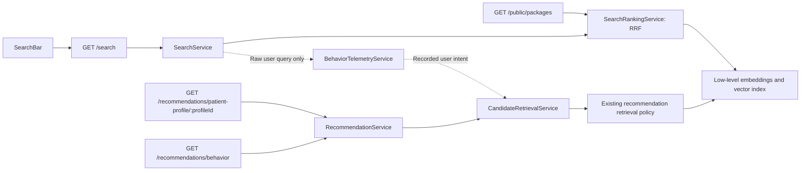

# Search boundary

Search owns its HTTP API, validation, catalog candidate cache and ranking policy.
The frontend's `SearchBar` calls `GET /search`. The former
`GET /recommendations/semantic-search` URL remains an alias handled by this module.



`SearchModule` imports `RecommendationModule` only to use its exported behavior
telemetry boundary. Recommendation does not import the search module or its ranker.
Its profile retrieval, behavior candidate retrieval and AI ranking
keep their existing policies. Low-level infrastructure and catalog metadata are
shared, so this is ranking isolation rather than separate infrastructure.

## Package ranking

1. Parse explicit price, age, gender, follow-up and exclusion constraints.
2. Apply constraints to active, deployed catalog candidates.
3. Build a keyword ranking using only package name and specialty name, taking the
   higher match score with no field weights; bounded typo rescue applies only
   when there are no keyword matches. This retriever is not BM25.
4. Retrieve up to 50 vector candidates by cosine similarity, without a fixed cutoff.
   A nearest match is not a guarantee of relevance; unrelated queries can return packages.
5. Sort keyword matches by match score and vector matches by cosine similarity.
   There is no separate exact-match promotion.
6. Fuse the first 50 unique results from each ranking using reciprocal rank fusion:
   `RRF(package) = sum(1 / (60 + rank))`, with ranks starting at 1. Missing packages
   contribute zero for that retriever. Count a package at most once per ranking.
   Both retrievers have equal weight; do not normalize or add their raw scores.
   Sort by fused score, with deterministic follow-up/price/ID tie breaks.
7. Apply the result limit after ranking. The catalog paginates this same ranking;
   explicit price/name sorting still overrides relevance sorting in the catalog.

Suggestions and catalog calls share a bounded five-minute query-vector cache and
deduplicate concurrent embedding requests. The candidate cache has its own
`search:cache:candidates:v1:*` namespace, invalidated with catalog updates.

If vector retrieval fails, valid keyword results remain available. If neither
retriever is available for an unmatched query, report an unavailable search rather
than a misleading successful empty result. Healthy retrievers may return zero hits.
Text queries use RRF even when only one retriever returns results. The internal
`semantic: false` comparison path and constraint-only queries retain keyword scores
and do not call the embedding provider. The compatibility response field
`similarityScore` contains the RRF score for hybrid text queries, not cosine
similarity. Constraint-only queries retain their existing score. Consumers must
preserve the returned order; these scores are not probabilities or clinical confidence.
Descriptions, symptoms and codes do not contribute positive keyword matches. They
remain available for explicit exclusion checks; semantic retrieval still uses package content.

## Behavior contract

Analytics keeps search request deduplication, search IDs and click attribution.
For a newly recorded complete search, behavior telemetry receives the original
user query and session/account ownership. It does not receive a specialty guessed
from the search result list. Recommendation interprets the saved query through its
own existing retrieval policy. Actual package views continue recording their
real package/specialty signals through the existing tracking endpoint.

## Validation

From `be_clinic`:

```powershell
npx tsc --noEmit
node node_modules/typescript/bin/tsc
node --test evaluation/search-ranking.test.cjs
```

Existing search evaluation reports were collected before RRF. Do not present them
as RRF results: rerun retrieval on the same fixed queries and review any newly
retrieved query/package pairs before calculating updated quality metrics.

RRF reference: https://www.elastic.co/docs/reference/elasticsearch/rest-apis/reciprocal-rank-fusion

The browser suite in `e2e` verifies the new API, legacy route, homepage search,
catalog controls, guest fallback, three patient profiles, behavior-only and combined
recommendations, profile switching, cache and account access boundaries.
Use a fresh `AUDIT_ID` for each full run because browsing history is persistent.
