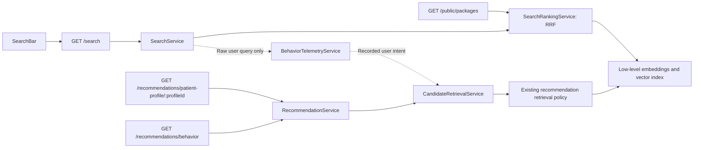

# Search boundary

Search owns its HTTP API, validation, catalog candidate cache and ranking policy.
The frontend's `SearchBar` calls `GET /search`. The former
`GET /recommendations/semantic-search` URL remains an alias handled by this module.



`SearchModule` imports `RecommendationModule` only to use its exported behavior
telemetry boundary. Recommendation does not import the search module or its ranker.
Its profile retrieval, behavior candidate retrieval and AI ranking
keep their existing policies. Low-level infrastructure and catalog metadata are
shared, so this is ranking isolation rather than separate infrastructure.

## Package ranking

1. Parse explicit price, age, gender, follow-up and exclusion constraints.
2. Apply constraints to active, deployed catalog candidates.
3. Build a keyword ranking using field matches; bounded typo rescue applies only
   when there are no keyword matches. This retriever is not BM25.
4. Retrieve up to 50 vector candidates and retain cosine similarity >= 0.82.
5. Combine the independently sorted lists using RRF: sum `1 / (60 + rank)`.
   A package contributes once per retriever. Missing packages contribute zero.
6. Prioritize exact package codes/full names. Break remaining ties deterministically.
7. Apply the result limit after ranking. The catalog paginates this same ranking;
   explicit price/name sorting still overrides relevance sorting in the catalog.

Suggestions and catalog calls share a bounded five-minute query-vector cache and
deduplicate concurrent embedding requests. The candidate cache has its own
`search:cache:candidates:v1:*` namespace, invalidated with catalog updates.

If vector retrieval fails, valid keyword results remain available. If neither
retriever is available for an unmatched query, report an unavailable search rather
than a misleading successful empty result. Healthy retrievers may return zero hits.
The compatibility response field `similarityScore` contains an RRF rank score,
not a probability or clinical confidence.

## Behavior contract

Analytics keeps search request deduplication, search IDs and click attribution.
For a newly recorded complete search, behavior telemetry receives the original
user query and session/account ownership. It does not receive a specialty guessed
from the RRF result list. Recommendation interprets the saved query through its
own existing retrieval policy. Actual package views continue recording their
real package/specialty signals through the existing tracking endpoint.

## Validation

From `be_clinic`:

```powershell
npx tsc --noEmit
```

The browser suite in `e2e` verifies the new API, legacy route, homepage search,
catalog controls, guest fallback, three patient profiles, behavior-only and combined
recommendations, profile switching, cache and account access boundaries.
Use a fresh `AUDIT_ID` for each full run because browsing history is persistent.
